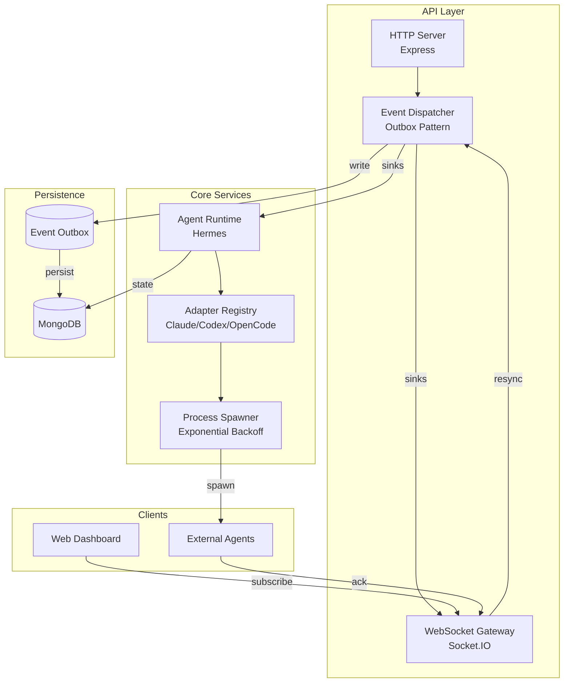

# RedHunter

Multi-agent orchestration platform with event-driven architecture, real-time synchronization, and vendor-agnostic adapter system.

## Overview

RedHunter coordinates autonomous agents across multiple LLM providers (Claude, Codex, OpenCode) through a centralized event dispatcher, real-time WebSocket gateway, and pluggable adapter system. Built for observability, fault tolerance, and deterministic replay.

## Architecture



## Quickstart

### Prerequisites

- Bun 1.0+
- MongoDB 7+
- Tailscale (optional, for remote access)

### Installation

```bash
# Install dependencies
bun install

# Start MongoDB via Docker
docker-compose up -d mongo

# Seed database (first run)
bun run seed

# Start API server
bun run dev
```

### Environment Variables

```bash
# Required
MONGO_URL=mongodb://localhost:27017/redhunter
JWT_SECRET=your-secret-key

# Optional
PORT=3000
CORS_ORIGINS=http://localhost:5173
LOG_LEVEL=info
```

## Core Concepts

### Event Dispatcher

Outbox-based event system ensuring at-least-once delivery with replay on failure:

- **MAX_DISPATCH_ATTEMPTS**: 5 retries before marking failed
- **Poll interval**: 250ms (configurable)
- **Batch size**: 100 events per tick
- **Recovery**: Failed events re-queued if attempts < max

### Real-time Gateway

Socket.IO namespace `/office` with JWT authentication:

- **Subscribe**: `subscribe:agent`, `subscribe:run`
- **Unsubscribe**: `unsubscribe:agent`, `unsubscribe:run`
- **Resync**: `resync` → full state snapshot (runs + agents)
- **Events**: `event`, `agent:event`, `run:event`

### Adapter System

Vendor-agnostic process spawning with automatic retry:

- **Exponential backoff**: 1s → 2s → 4s → 8s → 16s (max 30s)
- **Max retries**: 5 attempts
- **Process isolation**: `detached` mode with process group cleanup
- **Environment allowlist**: Strict env var filtering

### Agent Runtime

Hermes-based orchestration with constitution loading:

- **Prompt sources**: Hermes store, knowledge base, user context
- **Verification**: Completion verification before marking done
- **Usage tracking**: Token counts, duration, cost estimation

## Project Structure

```
redhunter/
├── apps/
│   ├── api/           # Express + Socket.IO server
│   └── web/           # React dashboard (Vite)
├── packages/
│   ├── adapters/      # Vendor adapters (Claude, Codex, OpenCode)
│   ├── agent-runtime/ # Hermes orchestration
│   ├── hermes/        # Prompt/knowledge management
│   └── shared/        # Shared types and utilities
└── agent-runtime/     # Legacy runtime (deprecated)
```

## Development

```bash
# Type check all packages
bun run typecheck

# Run tests
bun test

# Run specific test file
bun test apps/api/src/events/dispatcher.test.ts

# Lint
bun run lint
```

## Testing

```bash
# Unit tests
bun test

# Integration tests
bun test apps/api/src/pipeline.integration.test.ts

# Coverage
bun test --coverage
```

## Recovery Mechanisms

### Dispatcher Replay

Failed events automatically re-queue if `dispatchAttempts < MAX_DISPATCH_ATTEMPTS`. The dispatcher logs warnings and increments attempt counter on each failure.

### Socket Resync

Clients can request full state snapshot via `resync` event:

```typescript
socket.emit('resync', (response) => {
  if (response.ok) {
    const { runs, agents } = response;
    // Update local state
  }
});
```

### Adapter Crash Retry

Process spawn failures trigger exponential backoff:

- Attempt 0: immediate
- Attempt 1: 1s delay
- Attempt 2: 2s delay
- Attempt 3: 4s delay
- Attempt 4: 8s delay
- Max: 30s cap

## Documentation

- [Architecture](docs/architecture.md) - Detailed system design
- [Learnings](.omo/notepads/redhunter-master-plan/learnings.md) - Development patterns and decisions

## License

Private - RedHunter internal project
